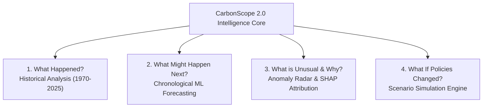

# CarbonScope 2.0: An Explainable Climate Intelligence & Greenhouse Gas Emission Forecasting System

[](https://www.python.org/)
[](https://streamlit.io/)
[](https://edgar.jrc.ec.europa.eu/report_2026)
[](https://creativecommons.org/licenses/by/4.0/)

CarbonScope 2.0 is an undergraduate Machine Learning and Climate Intelligence platform designed to analyze historical greenhouse gas emissions, forecast multi-decadal trajectory horizons, detect structural disruptions and anomalies, explain machine learning predictions using game-theoretic Explainable AI (SHAP), and simulate hypothetical decarbonization scenarios.

The system is built upon official greenhouse gas observations from the **European Commission Joint Research Centre (EDGAR 2026)** covering 208 sovereign nations and 56 continuous annual intervals (**1970 – 2025**).

---

## 1. Authoritative Data Source & Citation

- **Primary Source Agency:** European Commission, Joint Research Centre (JRC)
- **Database:** EDGAR (Emissions Database for Global Atmospheric Research) Community GHG Database, Release `EDGAR_2026_GHG` (2026)
- **Official Citation:**  
  > Crippa, M., Guizzardi, D., Pagani, F., Banja, M., Ciarlantini, S. et al., *GHG emissions of all world countries - 2026 Report*, Publications Office of the European Union, Luxembourg, 2026, [doi:10.2760/7717504](https://doi.org/10.2760/7717504), JRC147815.
- **Official Portal:** [https://edgar.jrc.ec.europa.eu/report_2026](https://edgar.jrc.ec.europa.eu/report_2026)
- **Global Warming Potentials:** IPCC AR5 100-year metrics ($\text{GWP}_{100}$: $\text{CO}_2=1$, $\text{CH}_4=28$, $\text{N}_2\text{O}=265$, F-gases variable).

---

## 2. Four Core Climate Questions Answered



1. **What Happened?** Analyzes 56 years of territorial emission trajectories across 208 sovereign nations, 8 economic pillars, and 4 Kyoto gas categories.
2. **What Might Happen Next?** Projects future decadal trajectories (2026–2035) using chronologically validated regression architectures equipped with recursive lag feedback.
3. **What is Unusual and Why?** Identifies macroeconomic shocks and structural disruptions (e.g. 1991 Soviet collapse, 2008 GFC, 2020 COVID-19 pandemic deflection) via Isolation Forest and Statistical Z-Score with automated root-cause explanations.
4. **What If Conditions Changed?** Simulates mathematical model response to hypothetical sectoral decarbonization targets and momentum damping factors with paired trajectory curves.

---

## 3. Modular Architecture

```
CarbonScope/
├── app.py                                   # Master Streamlit entry point
├── requirements.txt                         # Production package dependencies
├── README.md                                # Comprehensive academic documentation
├── .gitignore                               # Git hygiene definitions
│
├── data/
│   ├── raw/                                 # Pristine original EDGAR 2026 files (read-only)
│   │   ├── EDGAR_2026_GHG_booklet_2026.xlsx
│   │   ├── EDGAR_2026_GHG_booklet_2026_fossilCO2only.xlsx
│   │   └── GHG_emissions_of_all_world_countries_booklet_2026report.pdf
│   ├── processed/                           # Normalized tidy Parquet & CSV analytical panels
│   │   ├── master_emissions_panel.parquet
│   │   ├── ghg_totals_tidy.parquet
│   │   ├── ghg_sectors_tidy.parquet
│   │   ├── ghg_per_capita_tidy.parquet
│   │   └── ghg_per_gdp_tidy.parquet
│   └── external/
│       └── retrieval_metadata.json          # Cryptographic SHA-256 provenance registry
│
├── src/
│   ├── data_acquisition/
│   │   ├── edgar_downloader.py              # HTTP endpoint validation & upload ingestion
│   │   └── data_loader.py                   # Multi-sheet reader & PDF metadata extractor
│   ├── preprocessing/
│   │   ├── cleaner.py                       # Wide-to-long transformation & aggregate separation
│   │   ├── validator.py                     # Physical non-negativity & schema validation
│   │   └── quality_audit.py                 # Automated quality audit & decadal completeness
│   ├── analysis/
│   │   ├── eda.py                           # Statistical moments, CAGR & Gini coefficient
│   │   └── emission_analysis.py             # Global & India analytical profiles
│   ├── features/
│   │   └── feature_engineering.py           # Sequential lags, rolling windows & growth rates
│   ├── models/
│   │   ├── forecasting.py                   # Linear Regression, SVR, RF, Gradient Boosting
│   │   ├── evaluation.py                    # MAE, MSE, RMSE, R2, MAPE & residual engine
│   │   └── model_comparison.py             # Benchmark scorecards & markdown reporting
│   ├── anomaly/
│   │   ├── isolation_forest.py              # Multivariate ML Isolation Forest detector
│   │   └── statistical_detection.py         # Z-Score baseline dispersion detector
│   ├── explainability/
│   │   ├── shap_analysis.py                 # TreeSHAP, KernelSHAP & local waterfall plots
│   │   └── feature_importance.py           # Permutation importance & intrinsic weights
│   └── scenarios/
│       └── simulator.py                     # Baseline vs hypothetical scenario simulator
│
├── dashboard/
│   ├── ui_components.py                     # Shared dark design system (#0B1220, #14B8A6)
│   ├── overview.py                          # Module 1: Overview Dashboard
│   ├── data_intelligence.py                 # Module 2: Data Intelligence & Quality Audit
│   ├── emission_explorer.py                 # Module 3: Emission Explorer & World Map
│   ├── ml_laboratory.py                     # Module 4: ML Forecasting Engine
│   ├── anomaly_radar.py                     # Module 5: Emission Anomaly Radar
│   ├── explainability.py                    # Module 6: Explainability Centre
│   └── scenario_simulator.py                # Module 7: What-If Scenario Simulator
│
├── models/
│   └── trained_models/                      # Serialized trained model binaries (.pkl)
│
├── notebooks/                               # Google Colab & VS Code Jupyter notebooks
│   ├── 01_data_exploration.ipynb
│   ├── 02_data_preprocessing.ipynb
│   ├── 03_feature_engineering.ipynb
│   ├── 04_model_training.ipynb
│   ├── 05_anomaly_detection.ipynb
│   └── 06_shap_analysis.ipynb
│
└── reports/
    ├── data_quality/                        # Data dictionary & quality audit reports
    │   ├── data_dictionary.md
    │   ├── data_quality_audit.json
    │   └── data_quality_audit.md
    └── evaluation/                          # Model benchmark reports
        ├── india_benchmark.json
        └── india_benchmark.md
```

---

## 4. Machine Learning Methodology & Academic Defensibility

### 4.1. Zero Temporal Data Leakage
Standard random train-test splitting ($k$-fold cross-validation with random shuffling) produces temporal data leakage in time series by leaking future observations into past training states. In CarbonScope:
- **Training Window:** 1975 – 2015 (41 continuous historical years).
- **Out-of-Sample Test Window:** 2016 – 2025 (10 unseen terminal evaluation years).
- All rolling averages and growth rates at index $t$ are computed strictly using observations from $t-1$ and earlier.

### 4.2. Time-Series Extrapolation Mechanics
In economies undergoing continuous macroeconomic expansion (such as India's emissions rising from 3,100 Mt in 2015 to 4,508 Mt in 2025), tree ensembles (Random Forest, Gradient Boosting) are mathematically bounded by the minimum and maximum target values observed during training ($\le 3,100\text{ Mt}$). Consequently, linear regression equipped with lagged momentum and growth rate features often achieves superior out-of-sample generalization.

### 4.3. Physical Non-Negativity & Emission Flux
- Gross territorial emissions are mathematically constrained to be non-negative ($\ge 0\text{ Mt CO}_2\text{eq}$).
- EDGAR records annual territorial *flux rate* of emissions released at ground level ($\text{Mt CO}_2\text{eq/yr}$), distinct from atmospheric greenhouse gas *concentrations* (ppm) measured at atmospheric stations.

### 4.4. Explainable AI: Correlation vs Causality
SHAP values describe how input features contribute to the model's numerical predictions. They do **not** represent verified physical or ecological causal drivers.

---

## 5. Installation & Execution Guide

### 5.1. Local VS Code Environment (Windows PowerShell)

```powershell
# 1. Navigate to workspace root
cd d:\gwcccc

# 2. Create and activate a Python virtual environment
python -m venv venv
.\venv\Scripts\Activate.ps1

# 3. Upgrade pip and install production dependencies
pip install --upgrade pip
pip install -r requirements.txt

# 4. Execute the data cleaning and quality audit pipeline
python src/preprocessing/quality_audit.py

# 5. Launch the CarbonScope 2.0 Streamlit application
streamlit run app.py
```

The application will open automatically in your browser at `http://localhost:8501`.

### 5.2. Running Notebooks in Google Colab

1. Open Google Colab: [https://colab.research.google.com/](https://colab.research.google.com/)
2. Upload the desired notebook from `notebooks/` (e.g., `04_model_training.ipynb`).
3. Upload `EDGAR_2026_GHG_booklet_2026.xlsx` into Colab's file browser under `data/raw/` (or mount your Google Drive).
4. Run all cells sequentially. Models and evaluation scorecards are saved automatically.

---

## 6. Seven Platform Modules

| Module | Navigation | Key Features |
|---|---|---|
| **Module 1** | **Overview Dashboard** | Global trajectory (54.15 Gt), India profile (4,508 Mt, 8.33% share), Top emitters, 8 IPCC sector breakdown. |
| **Module 2** | **Data Intelligence** | HTTP endpoint status, cryptographic SHA-256 provenance, upload ingestion, decadal completeness matrix (100% core). |
| **Module 3** | **Emission Explorer** | Multi-country trajectories, stacked area sector evolution, choropleth planetary density world map, per-capita intensity. |
| **Module 4** | **ML Laboratory** | Linear Regression, SVR, Random Forest, Gradient Boosting, chronological holdout metrics, 95% confidence corridor. |
| **Module 5** | **Anomaly Radar** | Unsupervised Isolation Forest, Statistical Z-Score (2020 COVID shock, 2008 GFC), automated root-cause explanation table. |
| **Module 6** | **Explainability Centre** | Global $|SHAP|$ bar summary, individual prediction waterfall decomposition ($f(x) = E[f(X)] + \sum \phi_i$), permutation importance. |
| **Module 7** | **Scenario Simulator** | Interactive What-If simulation, sectoral decarbonization sliders, baseline vs scenario comparative curves, avoided carbon wedge. |

---

## 7. License & Data Terms of Use

All datasets from EDGAR (Emissions Database for Global Atmospheric Research) are licensed under the **Creative Commons Attribution 4.0 International (CC BY 4.0)** licence:
© European Union 2026, European Commission, Joint Research Centre (JRC).
This software platform is developed for academic climate intelligence research.

